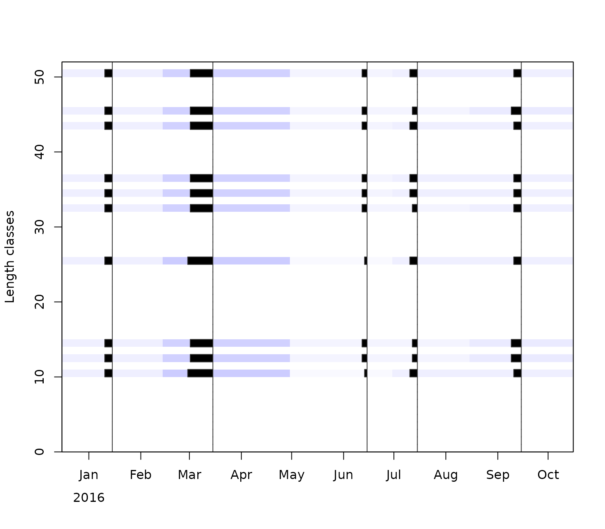
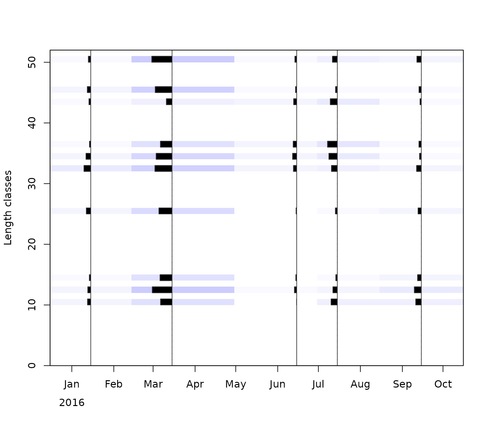
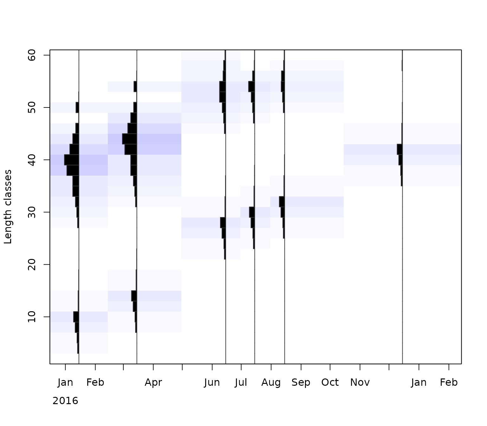

# Length-frequency data for TropFishR

## *Background*

Length-frequency data (LFQ) is collected by measuring the length of
focal fish species onboard of the fishing vessel, the landing site or
the fish market. Concerning fish there are three different lengths which
can be measured: standard length (SL), fork length (FL), and total
length (TL), for more information see
[**here**](https://www.fao.org/4/T0535E/T0535E02.htm). The big advantage
of LFQ data is that only a representative subsample of the total catch
is needed, meaning that not every fish in the catch has to be measured
if the subsample is random but representative. The sample should be
representative of the whole stock under investigation and for all
seasons of a year. Furthermore, enough samples of a range of different
fish lengths have to be measured in order for the methods of TropFishR
to work - a reference value is around 50 fish measurements per month.
Assuming that collected data are entered in some spreadsheet or text
format, this document will illustrate how different arrangements of data
can be read into R and converted to the LFQ list required by all methods
within TropFishR. No manual data input in R is required, The data used
in the examples below were generated randomly.

## *LFQ import*

There are three main ways in which you can arrange your data in a
spreadsheet or text file and easily import it into R an convert it to a
LFQ list (Fig. 1-3). Each of these 3 methods works evenly well with a
‘csv’, ‘xls’, or ‘txt’ file. For simplification, I will present all
three methods with ‘csv’ files and consequently demonstrate how to use a
‘xlsx’ and a ‘txt’ file. The example files are included in TropFishR
(folder ‘extdata’ of the installed package) and can be copied and opened
with a spreadsheet software to see their arrangement.
[`system.file()`](https://rdrr.io/r/base/system.file.html) returns the
path to these files; for your own data, use the path to your file
instead, e.g. `read.csv("C:/data/lfq1.csv")`. This vignette requires to
load the TropFishR package:

``` r

library(TropFishR)

## folder with the example files
system.file("extdata", package = "TropFishR")
#> [1] "/home/runner/work/_temp/Library/TropFishR/extdata"
```

### *Data arrangement 1*

The first data arrangement assumes that each measurement was inserted
into a specific cell in the spreadsheet, together with associated date
when this measurement was done.


Data arrangement 1. A column with dates and a column with length
measurements.

The data in this arrangement can be loaded into R by following code.

``` r

lfq1 <- read.csv(system.file("extdata", "lfq1.csv", package = "TropFishR"))
head(lfq1)
#>         date length
#> 1 15.01.2016     10
#> 2 15.01.2016     25
#> 3 15.01.2016     50
#> 4 15.01.2016     36
#> 5 15.01.2016     43
#> 6 15.01.2016     34

lfq1$date <- as.Date(lfq1$date, format = "%d.%m.%Y")

lfq1new <- lfqCreate(data = lfq1, Lname = "length", Dname = "date")

plot(lfq1new, Fname = "catch")
```



It is awlays important to convert the date information into the R class
‘Date’ which can be done by the function
[`as.Date()`](https://rdrr.io/r/base/as.Date.html). The second argument
in that function displays the format of the date in your data, ‘%d’
stand for the day, ‘%m’ for the month, and ‘%Y’ for the year with the
century, e.g. 2014, without the century it would be ‘%y’, e.g. 14. The
separator, here ‘.’, should be the same as in your data (see other
examples below). The function
[`lfqCreate()`](http://tokami.github.io/TropFishR/reference/lfqCreate.md)
is a handy function, which allows you to convert the dataframe into a
list in the right format. The arguments ‘Lname’ and ‘Dname’ define the
names of the columns in your dataframe with the length measurements and
the dates, respectively. They should correspond to `colnames(lfq1)`.
Besides the arguments above it allows for many other adjustments, such
as setting the bin size or aggregating the data monthly, see
[`?lfqCreate`](http://tokami.github.io/TropFishR/reference/lfqCreate.md)
for more information.

### *Data arrangement 2*

The second data arrangement represents the case with an additional
column which contains the number of times the length was measured at
respective date.


Data arrangement 2. A column with dates, one with length measurements,
and one with the frequency of the length at respective date.

Data of this arrangement can be loaded into R by following code.

``` r

lfq2 <- read.csv2(system.file("extdata", "lfq2.csv", package = "TropFishR"))
head(lfq2)
#>       DATE Length_CM Frequency
#> 1 15/01/16      10.0         3
#> 2 15/01/16      25.5         5
#> 3 15/01/16      50.5         2
#> 4 15/01/16      36.0         6
#> 5 15/01/16      43.5        10
#> 6 15/01/16      34.0        23

lfq2$DATE <- as.Date(lfq2$DATE, format = "%d/%m/%y")

lfq2new <- lfqCreate(data = lfq2, Lname = "Length_CM", Dname = "DATE", Fname = "Frequency")

plot(lfq2new, Fname = "catch")
```

 This file is
separated by semicolons and uses a comma as decimal separator (as
spreadsheet software with European settings exports csv files), which is
the default of [`read.csv2()`](https://rdrr.io/r/utils/read.table.html);
use [`read.csv()`](https://rdrr.io/r/utils/read.table.html) for files
separated by commas with a point as decimal separator, as in the first
example. Always check the imported data, e.g. with
[`head()`](https://rdrr.io/r/utils/head.html) or
[`str()`](https://rdrr.io/r/utils/str.html): if all values end up in one
column, the separator is wrong, and if the lengths are characters
instead of numbers, the decimal separator is wrong. Be aware of the
different date format, the different column headers or names and the
additional argument in the function
[`lfqCreate()`](http://tokami.github.io/TropFishR/reference/lfqCreate.md)
called ‘Fname’ displaying the name of the column with the frequency
information.

### *Data arrangement 3*

The last data arragement presented here, assumes that the data was
already sorted into length classes within your spreadsheet. The first
column does now represent the length classes and the number of times
each length class was observed at repsective sampling times is in the
subsequent columns, where each column represent one sampling time (here
aggregated per month). In this example, the information about the date
is contained within the header of the not-length-class columns (cp Fig.
3). This is however not necessary and the date information can also be
added manually in R.


Data arrangement 3. A column with the length classes and subsequent
columns with the frequency of observed lengths for several sampling
times.

Data in this arrangement have to be treated a little differently:

``` r

lfq3 <- read.csv(system.file("extdata", "lfq3.csv", package = "TropFishR"),
                 check.names = FALSE)
head(lfq3)
#>   lengthClass 2016-01-15 2016-03-15 2016-06-15 2016-07-15 2016-08-15 2016-12-15
#> 1           2         NA         NA         NA         NA         NA         NA
#> 2           4          5         NA         NA         NA         NA         NA
#> 3           6          7         NA         NA         NA         NA         NA
#> 4           8         14          5         NA         NA         NA         NA
#> 5          10         20          7         NA         NA         NA         NA
#> 6          12          3         14         NA         NA         NA         NA

dates <- as.Date(colnames(lfq3)[-1], format = "%Y-%m-%d")
dates
#> [1] "2016-01-15" "2016-03-15" "2016-06-15" "2016-07-15" "2016-08-15"
#> [6] "2016-12-15"

lfq3new <- list(dates = dates,
                midLengths = lfq3$lengthClass,
                catch = as.matrix(lfq3[,-1]))
class(lfq3new) <- "lfq"
lfq3new$catch[is.na(lfq3new$catch)] <- 0

plot(lfq3new, Fname = "catch")
```

 In this case, the
function
[`lfqCreate()`](http://tokami.github.io/TropFishR/reference/lfqCreate.md)
can not be used, instead the data is arranged into a list manually. The
dates are taken from the column names. By default, R changes column
names that do not start with a letter, e.g. ‘2016-01-15’ becomes
‘X2016.01.15’; the argument `check.names = FALSE` keeps the original
names. Check that none of the dates is `NA`, which happens if the format
in [`as.Date()`](https://rdrr.io/r/base/as.Date.html) does not match the
dates in your file. If the dates are not in the header of your file,
they can be entered manually,
e.g. `dates <- as.Date(c("2016-01-15", "2016-03-15", ...))`, with one
date per column. Next, the dates, mid lengths and the catch matrix can
be directly arranged together with the function
[`list()`](https://rdrr.io/r/base/list.html). It is of crucial
importance to use the exact names and spelling (incl. case sensitivity)
in the list (‘dates’, ‘midLengths’, ‘catch’). with the function
[`class()`](https://rdrr.io/r/base/class.html) the TropFishR internal
class ‘lfq’ can be assigned to the created list. Missing values in the
catch matrix (`NA`, `NaN`) should be put to 0.

### *Other file formats*

Of course, your data has not to be in the csv format, it can just as
well be ‘odt’, ‘xls’, ‘xlsx’, ‘txt’ or any text file. Other formats
require different functions to load the data into R (beside
[`read.csv2()`](https://rdrr.io/r/utils/read.table.html)). The following
code demonstrats this for a ‘xlsx’ and ‘txt’ file.

``` r

lfq2a <- read.table(system.file("extdata", "lfq2.txt", package = "TropFishR"),
                    header = TRUE, sep = "\t", dec = ",")
head(lfq2a)
#>       DATE Length_CM Frequency
#> 1 15/01/16      10.0         3
#> 2 15/01/16      25.5         5
#> 3 15/01/16      50.5         2
#> 4 15/01/16      36.0         6
#> 5 15/01/16      43.5        10
#> 6 15/01/16      34.0        23
```

``` r

install.packages("openxlsx")
library(openxlsx)
lfq3a <- read.xlsx(system.file("extdata", "lfq3.xlsx", package = "TropFishR"),
                   sheet = 1, check.names = FALSE, sep.names = "-")
```

The function [`read.table()`](https://rdrr.io/r/utils/read.table.html)
allows to read and load many different file formats into R, The
arguments ‘sep’ and ‘dec’ control the separator between columns (here
tabstop) and the decimal separator (here comma), respectively.
Additional arguments like ‘fileEncoding’ and ‘skipNul’ might be
necessary to use for controlling the encoding of the file and if nuls
should be skipped. More information about the arguments can be viewed
with [`?read.table`](https://rdrr.io/r/utils/read.table.html). There are
many different R packages available to read ‘xls’ and ‘xlsx’ files into
R, one of the fastest is openxlsx, but it does not allow to read in
‘xls’ files. For this you might consider using the package ‘xlsx’. These
functions allow you to read in any sheet of your ‘xlsx’ file by using
the ‘sheet’ argument.

## *Data of several years*

The lfq data are not limited to one year. The catch matrix has one
column per sampling time, and the dates can span several years; each
column just needs its correct date. With data arrangement 1 or 2,
[`lfqCreate()`](http://tokami.github.io/TropFishR/reference/lfqCreate.md)
builds the lfq data for any number of years from the dates of the
measurements. With data arrangement 3, the dates of all columns are
added, e.g. for monthly samples from January 2022 to December 2023 (here
with random numbers instead of the data read from a file):

``` r

## data arrangement 3: length classes and 24 monthly samples
set.seed(1)
lfq4 <- data.frame(lengthClass = seq(2.5, 29.5, 1),
                   matrix(rpois(28 * 24, 10), ncol = 24))

## mid-month dates of the samples, Jan 2022 to Dec 2023
dates <- as.Date(paste0("15-", rep(1:12, 2), "-", rep(2022:2023, each = 12)),
                 format = "%d-%m-%Y")

lfq4new <- list(dates = dates,
                midLengths = lfq4$lengthClass,
                catch = as.matrix(lfq4[,-1]))
class(lfq4new) <- "lfq"
range(lfq4new$dates)
#> [1] "2022-01-15" "2023-12-15"
```

The growth methods (`ELEFAN`, `ELEFAN_SA`, `ELEFAN_GA`) use all samples
together, which helps to follow cohorts over a longer time. The catch
curve (`catchCurve`) and `VPA` assume a representative sample of the
catch of one year (or the average of several years).
[`lfqModify()`](http://tokami.github.io/TropFishR/reference/lfqModify.md)
sums the samples per year (one column per year) or selects the samples
of certain years:

``` r

## one column per year
lfq4year <- lfqModify(lfq4new, vectorise_catch = TRUE)
colnames(lfq4year$catch)
#> [1] "X2022" "X2023"

## samples of 2023 only
lfq4_2023 <- lfqModify(lfq4new, years = 2023)
ncol(lfq4_2023$catch)
#> [1] 12
```

With the catch per year, the argument `catch_columns` of `catchCurve`
and `VPA` selects one year or several years (summed), e.g.
`catchCurve(lfq4year, catch_columns = 2)` for 2023.

## *Sampled numbers and total catch*

The catch matrix of the lfq data (`catch`) should contain the numbers of
fish measured per length class and sampling time, as in the examples
above. Most methods of TropFishR only use the relative length
composition of these samples and do not require the total catch: the
growth methods (e.g. `ELEFAN_GA`), the length-converted catch curve
(`catchCurve`) and the yield per recruit models (`predict_mod` with the
selectivity and fishing mortality of the catch curve). The bootstrapped
methods (e.g. `ELEFAN_GA_boot`) even require the sampled numbers,
because they resample the measured fish.

Only the length-based virtual population analysis (`VPA`) estimates
absolute numbers and requires the total catch of the stock. The samples
have to be raised to the total catch, which is usually done with the
total landings in weight: the raising factor of each sample is the
landings divided by the weight of the sample. If the weight of the
samples was not measured, it is estimated from the numbers per length
class and the length-weight relationship ($`W = a L^b`$). The function
`lfqRaise` does this, but it is easier to keep the sampled numbers in
the lfq data and to pass the landings in kg directly to `VPA` (argument
`landings`), which raises the samples internally:

``` r

library(TropFishR)
data(synLFQ7)
lfq <- synLFQ7
lfq$par <- list(Linf = 123, K = 0.2, t0 = 0, M = 0.2,
                a = 0.015, b = 3)   # length-weight relationship with W in g
## landings in kg at the sampling dates (here simply assumed)
landings <- c(20000, 25000, 30000, 35000, 40000, 30000, 25000, 20000)

## raising factors (landings / weight of the samples)
lfqRaise(lfq, landings = landings, LW_unit = "g")$raising
#>       sample landings sampleWeight estimated   factor
#> 1 2016-01-01    20000     14836.23      TRUE 1.348051
#> 2 2016-03-02    25000     15289.33      TRUE 1.635127
#> 3 2016-04-02    30000     15659.33      TRUE 1.915791
#> 4 2016-07-02    35000     15974.05      TRUE 2.191053
#> 5 2016-08-01    40000     16554.03      TRUE 2.416331
#> 6 2016-10-01    30000     14380.58      TRUE 2.086146
#> 7 2016-11-01    25000     14515.66      TRUE 1.722278
#> 8 2016-12-01    20000     14859.87      TRUE 1.345906

## plus group below Linf and VPA with the raised catch
pg <- lfq$midLengths[max(which(lfq$midLengths < lfq$par$Linf))]
lfq <- lfqModify(lfq, plus_group = pg)
res <- VPA(lfq, landings = landings, terminalE = 0.5, LW_unit = "g")
```

With `by = "sample"` (in `VPA`: `raiseBy = "sample"`, the default) each
sample is raised with its own landings, which also gives months with
large landings more weight than months with small landings. If the
landings are only known per year, use `raiseBy = "year"` and one value
per year. If the landings only cover a part of the catch of the stock
(e.g. one of several fleets), the argument `catch_corFac` of `VPA`
allows an additional raising factor. The option `catch_unit = "kg"` of
`VPA` is meant for catches in weight *per length class*, not for the
total landings.

## *Conclusion*

This vignette demonstrates the first step in the application of
TropFishR, the arrangement of your length measurements in a spreadsheet
(or text file) and the import into R. Nevertheless, this step is
important and several requests motivated me to write this vignette. How
you can use TropFishR for the further analysis of your data is
demonstrated in the detailed
[**tutorial**](https://tokami.github.io/TropFishR/articles/tutorial.html).
